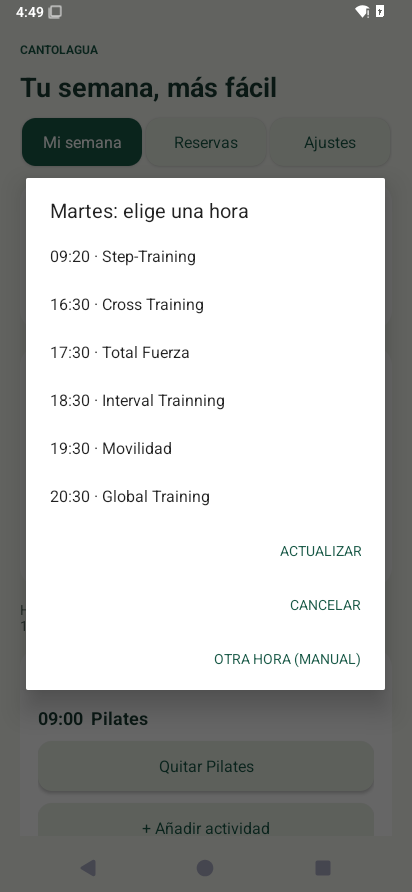

# Validación de la entrega 1.0.1

Fecha: 18 de octubre de 2026. Paquete: `es.cantolagua.misemana`. Versión de Android: mínimo 8/API 26; compilación y destino API 35. VersionCode 2, misma firma que 1.0.0.

## Corrección del horario semanal

La versión anterior sustituía todo el catálogo guardado con cada consulta. Una publicación parcial podía hacer perder los demás días; además, la selección manual ofrecía una lista general de nombres sin hora. Ahora el horario consultado se conserva por **día de la semana y hora**, separado de las reservas elegidas y de sus resultados.

- Cada opción empieza por su hora. El martes empieza por **09:20 · Step-Training**; el Pilates de las 09:00 corresponde al lunes.
- La clase conserva su hora concreta, aunque la fila general de la tabla web indique otra franja (09:00 frente a 09:20).
- Una consulta que solo devuelve el lunes conserva martes a viernes de consultas anteriores.
- Una observación más reciente actualiza esa combinación de día y hora; una publicación antigua no la sustituye. Se conservan las actividades simultáneas.
- Siempre se ofrecen horas habituales. Cuando no se conoce la clase, se muestra **Actividad pendiente de consultar**; no se toma el nombre de otro día.
- La actualización del APK conserva credenciales y planificación. El catálogo antiguo se migra; el selector consulta de nuevo con la cuenta guardada y conserva las observaciones anteriores.
- El servicio de reservas también guarda los horarios que consulta. Sigue resolviendo el identificador concreto de la sesión en el momento de reservar, sin reutilizar identificadores de sesiones pasadas.

## Evidencia de esta entrega

- **58 pruebas JVM correctas:** 39 de integración/calendario/reservas y 19 del horario guardado. Cubren el ejemplo del martes, los demás días, consultas parciales, persistencia, migración, semanas posteriores, actividades simultáneas y horas sin nombre.
- **18 pruebas del selector en Android 15 correctas en el APK final:** se pulsaron los botones reales de lunes a jueves, se verificaron las primeras opciones y las horas de cada fila, y se seleccionó la actividad comprobando su día y hora guardados. El viernes sin información ofrece horas sin inventar Pilates.
- **19 pruebas generales en Android 15 correctas en el APK final:** Keystore, persistencia, plantilla, excepciones, exclusión de duplicados, tres pestañas y arranque desde alarma exacta con la interfaz cerrada.
- **Actualización comprobada desde 1.0.0:** dos comprobaciones adicionales verificaron la conservación de contraseña cifrada y selección semanal con datos sintéticos. Las dos versiones tienen el mismo certificado de firma.
- **Consulta autenticada real de solo lectura:** Cantolagua devuelve 26 sesiones; se confirmó Step-Training el martes a las 09:20. La contraseña se introdujo de forma interactiva, no se guardó en fuentes, pruebas ni APK. La muestra HTML de pruebas procede exclusivamente del calendario público, sin datos de la cuenta.
- APK firmado con firmas v2/v3 válidas y SHA-256 adyacente. Compilación de distribución sin `debuggable`, sin tráfico HTTP claro y sin copia de seguridad de datos.

Captura del selector real del martes durante la prueba de Android:



Los resultados de dispositivo están en `artifacts/comprobaciones-android-1.0.1.txt`. No se ha enviado ninguna reserva real nueva ni se ha repetido la inscripción en lista de espera completada anteriormente.

## Regla de reserva

Se mantiene la regla confirmada por el usuario: **cuatro días naturales antes, a la misma hora de cada sesión, Europe/Madrid**. El lunes 17:30 se reserva el jueves anterior 17:30; martes el viernes; miércoles el sábado; jueves el domingo; viernes el lunes. Los cambios de hora se calculan en la zona del centro.

## Repetir la validación

```sh
python3 scripts/bootstrap_android.py
bash scripts/test.sh
bash scripts/build_android.sh
bash scripts/build_device_tests.sh
```

**Solo en un emulador aislado: la instrumentación borra los datos locales de Mi Cantolagua.**

```sh
adb install -r artifacts/MiCantolagua-1.0.1.apk
adb install -r android/build/device-tests/device-tests.apk
adb shell appops set es.cantolagua.misemana SCHEDULE_EXACT_ALARM allow
adb shell pm grant es.cantolagua.misemana android.permission.POST_NOTIFICATIONS
adb shell am instrument -w es.cantolagua.misemana.tests/es.cantolagua.misemana.CalendarDeviceChecks
adb shell am instrument -w es.cantolagua.misemana.tests/es.cantolagua.misemana.DeviceChecks
```

Resultados esperados: `18 calendar device checks passed` y `19 device checks passed`. Una finalización del comando sin esos resultados no cuenta como prueba correcta. Para repetir la comprobación de actualización, instala primero 1.0.0, ejecuta `UpgradeSeed` con la APK de instrumentación firmada, instala 1.0.1 sin desinstalar y ejecuta `CalendarDeviceChecks` con `-e expectUpgrade true`. Esta última ejecución incluye dos comprobaciones adicionales y devuelve 20.

## Límites

El emulador no tiene aceleración por hardware y se amplió su watchdog durante su arranque. La aplicación distribuida no depende de ese ajuste. No se han probado las políticas de batería de todos los fabricantes ni la red móvil del usuario. La primera reserva programada completa todavía debe observarse en el teléfono real.

El teléfono necesita permisos, Internet, estar encendido y haberse desbloqueado una vez tras reiniciar. No se garantiza obtener plaza. Los nombres guardados son referencias de consultas previas: una reserva solo se envía cuando el calendario actual confirma exactamente la actividad, fecha y hora elegidas.
